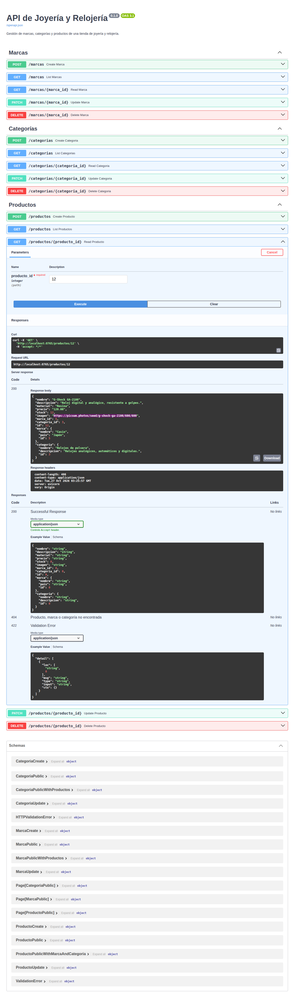

# EFI Python - API de Joyería y Relojería

API REST construida con FastAPI y SQLModel para una tienda de joyería y relojería. Gestiona marcas, categorías y productos, y es la API que consume el frontend en React del EFI de JavaScript.

## Integrantes

- Altamirano, Julian
- Sosa Zabala, Rodrigo Ezequiel

## Modelos

| Modelo | Campos | Relación |
| --- | --- | --- |
| `Marca` | nombre, país | Una marca tiene muchos productos |
| `Categoria` | nombre, descripción | Una categoría tiene muchos productos |
| `Producto` | nombre, descripción, material, precio, stock, imagen | Pertenece a una marca (`marca_id`) y a una categoría (`categoria_id`) |

## Cómo correrlo

Requiere [uv](https://docs.astral.sh/uv/).

```bash
uv sync                      # instala las dependencias
uv run alembic upgrade head  # crea la base joyeria.db con las tablas
uv run python -m src.seed    # carga marcas, categorías y productos de ejemplo
uv run fastapi dev src/main.py
```

La API queda en `http://localhost:8000` y la documentación interactiva en `http://localhost:8000/docs`.

En producción, definir la variable `FRONTEND_URL` con el dominio del frontend (por ejemplo `https://efi-javascript.vercel.app`) para que CORS lo permita.

Sin uv: `pip install -r requirements.txt` y los mismos comandos sin `uv run`.

El script de datos de ejemplo no hace nada si la base ya tiene marcas. Para volver a cargarlos desde cero, borrar `joyeria.db` y repetir `alembic upgrade head` y `python -m src.seed`.

## Endpoints

Cada modelo tiene cinco endpoints: `marcas`, `categorias` y `productos`.

| Método | Ruta | Descripción |
| --- | --- | --- |
| `POST` | `/productos` | Crea un producto (201) |
| `GET` | `/productos?page=1&size=50` | Lista paginada |
| `GET` | `/productos/{id}` | Detalle con datos anidados |
| `PUT` / `PATCH` | `/productos/{id}` | Actualiza campos enviados (soporta PUT y PATCH) |
| `DELETE` | `/productos/{id}` | Elimina (204, sin cuerpo) |

- El listado devuelve `{ items, total, page, size, pages }`.
- `GET /productos` acepta además los filtros `marca_id` y `categoria_id`.
- El detalle de un producto incluye su `marca` y su `categoria` (`ProductoNested`); el de una marca o categoría incluye sus `productos` (`MarcaNested` y `CategoriaNested`).
- Si el id no existe se responde 404. Crear o editar un producto con una marca o categoría inexistente también da 404.
- No se puede borrar una marca o categoría que todavía tiene productos: se responde 409.
- El `precio` viaja como texto (`"10500.00"`) para no perder decimales.

## Migraciones

Las migraciones están en `alembic/versions/`. Si se cambia un modelo:

```bash
uv run alembic revision --autogenerate -m "descripcion del cambio"
uv run alembic upgrade head
```

## Estructura

```
├── alembic/            # migraciones
├── alembic.ini
├── requirements.txt
└── src/
    ├── main.py         # app, CORS, routers y paginación
    ├── database.py     # engine de SQLite y sesión
    ├── seed.py         # datos de ejemplo
    ├── models/         # modelos, schemas de entidad y anidados.py
    └── routers/        # endpoints de cada entidad (CRUD)
```

## Captura de /docs



## Créditos de las imágenes

Las imágenes de los datos de ejemplo tienen licencia libre. Son fotos ilustrativas, no de los productos reales de cada marca.

| Producto | Autor | Licencia | Fuente |
| --- | --- | --- | --- |
| Love Bracelet | Sin autor indicado | CC0 1.0 | [Ver](https://www.rawpixel.com/image/11524339/photo-image-gold-public-domain-ring) |
| Trinity Ring | zeevveez | CC BY 2.0 | [Ver](https://www.flickr.com/photos/29001414@N00/2912886508) |
| Tank Must | GuySie | CC BY-SA 2.0 | [Ver](https://www.flickr.com/photos/76491533@N00/8726195627) |
| Solitario Tiffany Setting | Instant Vantage | CC BY-SA 2.0 | [Ver](https://www.flickr.com/photos/44312356@N04/8856273094) |
| Return to Tiffany Heart Tag | anniehp | CC BY 2.0 | [Ver](https://www.flickr.com/photos/41869756@N05/4310572058) |
| Pulsera Moments | CosmoPolitician | CC BY 2.0 | [Ver](https://www.flickr.com/photos/92705627@N00/5414491162) |
| Collar Corazón Brillante | The ChainMaille Lady | CC BY 2.0 | [Ver](https://www.flickr.com/photos/26800041@N04/5034602602) |
| G-Shock GA-2100 | GuySie | CC BY-SA 2.0 | [Ver](https://www.flickr.com/photos/76491533@N00/5090839386) |
| Aros HardWear | Christine Gierer | CC BY-SA 2.0 | [Ver](https://www.flickr.com/photos/97925861@N00/7108432427) |
| Aros Estrella | Star Harvest Silver Jewelry | CC BY-SA 2.0 | [Ver](https://www.flickr.com/photos/127460190@N03/15469374956) |
| Vintage A168 | John Booty | CC BY 2.0 | [Ver](https://www.flickr.com/photos/53874519@N00/51500724840) |
| Submariner Date | Sin autor indicado | Dominio público | [Ver](https://commons.wikimedia.org/wiki/File:Rolex-Submariner.jpg) |
| Datejust 36 | Sin autor indicado | CC0 1.0 | [Ver](https://commons.wikimedia.org/wiki/File:Rolex_Datejust_16013.jpg) |
